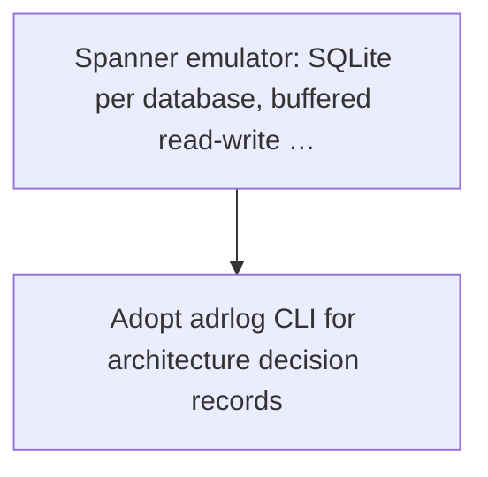

# Decision records

<!-- Generated by `adrlog index`. Do not edit by hand. -->

| Record | Status | Date | Tags |
|---|---|---|---|
| [Spanner emulator: SQLite per database, buffered read-write transactions](20261126-162636-spanner-emulator-sqlite-per-database-buffered.md) | proposed | 2026-11-26 | spanner, engine |
| [Adopt adrlog CLI for architecture decision records](20261125-231025-adopt-adrlog-cli-for-architecture-decision.md) | accepted | 2026-11-25 | process, documentation |

## Graph

