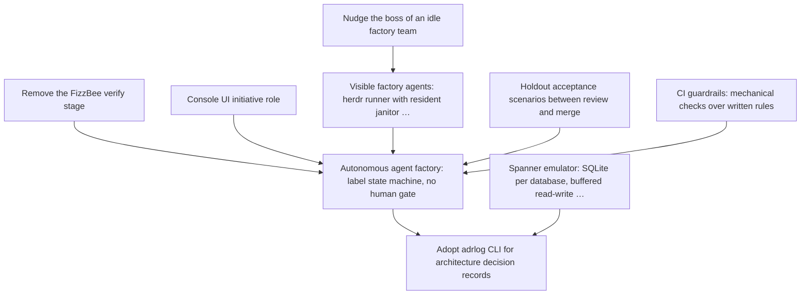

# Decision records

<!-- Generated by `adrlog index`. Do not edit by hand. -->

| Record | Status | Date | Tags |
|---|---|---|---|
| [Remove the FizzBee verify stage](20261127-210523-remove-the-fizzbee-verify-stage.md) | accepted | 2026-11-27 | process, factory |
| [Nudge the boss of an idle factory team](20261127-201615-nudge-the-boss-of-an-idle.md) | accepted | 2026-11-27 | process, factory, herdr |
| [Console UI initiative role](20261127-121826-console-ui-initiative-role.md) | accepted | 2026-11-27 | process, factory, console |
| [Visible factory agents: herdr runner with resident janitor and scout](20261126-233622-visible-factory-agents-herdr-runner-with.md) | accepted | 2026-11-26 | process, factory |
| [Holdout acceptance scenarios between review and merge](20261126-221104-holdout-acceptance-scenarios-between-review-and.md) | accepted | 2026-11-26 | process, factory |
| [CI guardrails: mechanical checks over written rules](20261126-214345-ci-guardrails-mechanical-checks-over-written.md) | accepted | 2026-11-26 | process, ci |
| [Autonomous agent factory: label state machine, no human gate](20261126-211742-autonomous-agent-factory-label-state-machine.md) | accepted | 2026-11-26 | process, factory |
| [Spanner emulator: SQLite per database, buffered read-write transactions](20261126-162636-spanner-emulator-sqlite-per-database-buffered.md) | accepted | 2026-11-26 | spanner, engine |
| [Adopt adrlog CLI for architecture decision records](20261125-231025-adopt-adrlog-cli-for-architecture-decision.md) | accepted | 2026-11-25 | process, documentation |

## Graph

